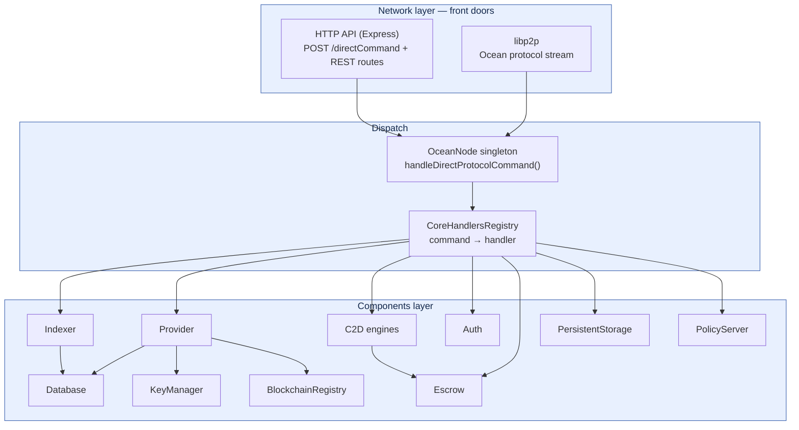
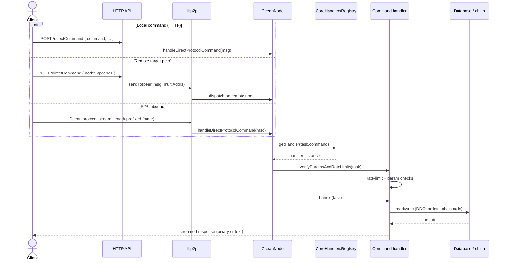
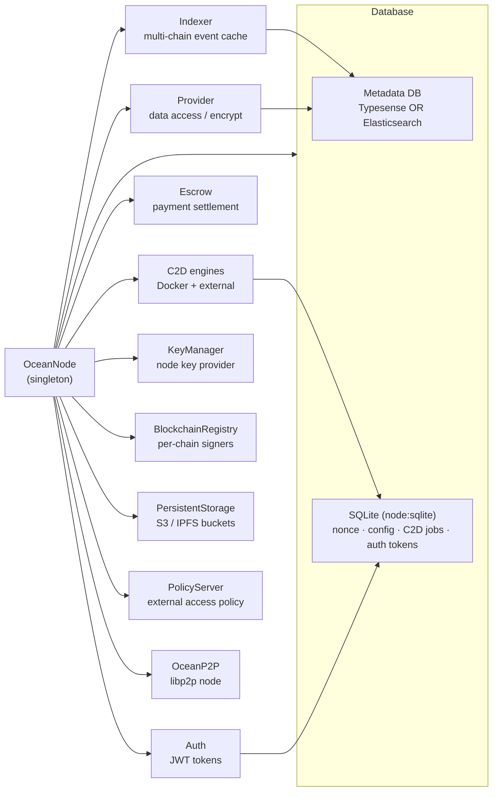
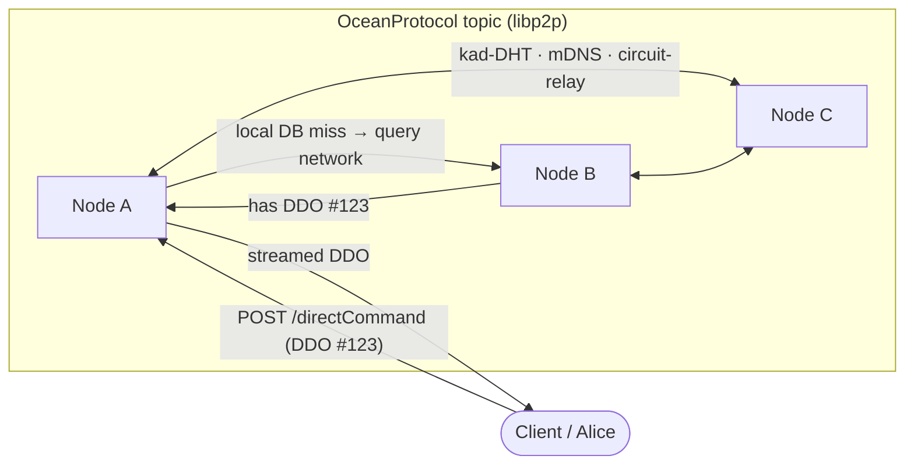
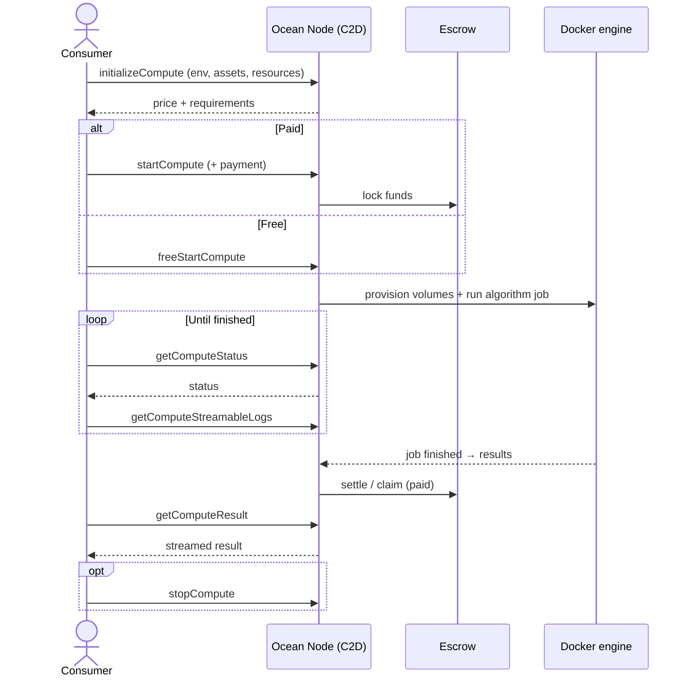

#  Ocean Node Architecture Overview

**Author(s)**:
- [Alex Coseru](https://github.com/alexcos20)

**Maintainer(s)**:
- Ocean Protocol core team

* * *

**Abstract**

This document describes the Ocean Node architecture: its layers, components, modules,
and how a request flows through the system. Ocean Node is the all-in-one backend for the
Ocean Protocol stack — a single process that replaces three legacy components:
**Provider** (data access / encryption / compute), **Aquarius** (metadata cache), and the
**subgraph** (on-chain event indexing).

This is not an introduction to Ocean Protocol concepts. For that, start with the
[Ocean docs](https://docs.oceanprotocol.com/). The text below assumes familiarity with
Ocean terminology (DDOs, data NFTs, datatokens, C2D, fees).

> **Note on the filename.** The file is intentionally named `Arhitecture.md` for backward
> compatibility with existing links; the content uses the correct spelling throughout.

# Table of Contents
- [1. Architecture Overview](#1-architecture-overview)
- [2. Request & Command Flow](#2-request--command-flow)
- [3. Components](#3-components)
- [4. Nodes & Network Model](#4-nodes--network-model)
- [5. Compute-to-Data (C2D)](#5-compute-to-data-c2d)
- [6. Related Documentation](#6-related-documentation)

---

# 1. Architecture Overview

The node stack is divided into three layers:

- **Network layer** — the two front doors: an Express **HTTP API** and a **libp2p** P2P
  interface. Both normalize an incoming request into a single `Command` object.
- **Components layer** — the long-lived services wired together by the `OceanNode`
  singleton: Indexer, Provider, C2D engines, Database, P2P, Auth, KeyManager,
  BlockchainRegistry, Escrow, PersistentStorage, PolicyServer.
- **Handlers (modules) layer** — the concrete command handlers under
  `src/components/core/` that execute the actual work.

The key architectural idea: **every capability is a command handler**, reachable
identically over HTTP `/directCommand`, over P2P, and (for most) via a dedicated REST route.

**Design features**

- Node identity is derived from a single `PRIVATE_KEY`: it seeds the libp2p peerId, the EVM
  signer, and the encryption keys ([libp2p supports ECDSA key pairs](https://github.com/libp2p/specs/blob/master/peer-ids/peer-ids.md#ecdsa)).
- Each component can be enabled/disabled at startup (e.g. run with `INTERFACES=["HTTP"]`
  only, or without the Indexer when no metadata DB is configured).
- Multiple C2D engine types are supported: a light Docker engine (edge nodes) and external
  Ocean C2D / third-party clusters.
- URL/metadata protection: the node encrypts URLs on publish and only ever streams data,
  never the URL. Confidential-compute (TEE) and MPC approaches are described in
  [§6](#6-security-modules).

---

# 2. Request & Command Flow

There are two front doors but a single dispatcher. `OceanNode.handleDirectProtocolCommand()`
is the one choke point: it JSON-parses the command, looks up the handler by `task.command`
in the `CoreHandlersRegistry`, and calls `handler.handle(task)`. Handlers first run
`verifyParamsAndRateLimits()` (shared rate limiting against `OceanNode.requestMap`), then
execute and stream the response back.

**Forwarding.** If a node receives a request for an object it does not have locally and P2P
is enabled, it can forward the request to the network and relay the answer back. (Example:
Alice asks Node A for DDO `#123`; Node A checks its local DB, and if missing, queries the
network and returns the DDO from a peer that has it.)

**To add a new command:** add the name to `PROTOCOL_COMMANDS` + `SUPPORTED_PROTOCOL_COMMANDS`
(`src/utils/constants.ts`), create a handler under `src/components/core/`, register it in the
`CoreHandlersRegistry` constructor, add param validation, and optionally add a REST route in
`src/components/httpRoutes/`.

---

# 3. Components

### 3.1 Indexer
An off-chain, multi-chain metadata & chain-events cache (the V4 Aquarius + subgraph
equivalent). Single-threaded, non-blocking: one `ChainIndexer` per configured chain runs
concurrently on the event loop (**no worker threads**); event **processors** handle specific
events.

- Monitors `MetadataCreated` / `MetadataUpdated` / `MetadataState` and stores/validates DDOs
  against multiple SHACL schemas; provides proof for valid DDOs.
- Monitors datatoken contracts and stores orders (`OrderStarted` / `OrderReused`).
- Monitors Escrow events (Auth, Lock, Claimed, Canceled, Deposit, Withdraw) and exchange /
  dispenser / access-list lifecycle events.
- Supports queries for all of the above, version-based + admin-triggered reindexing, and a
  purgatory. Communicates via module-level `EventEmitter`s.

### 3.2 Provider
Deliberately thin — the real behavior lives in the core handlers and REST routes. It:
- checks on-chain buyer permissions and payments;
- encrypts URLs/metadata on publish and decrypts on download or compute start;
- streams data to consumers and **never** exposes the URL;
- connects to the C2D engines for compute services.

### 3.3 Database
The metadata DB backend is pluggable — **Typesense or Elasticsearch** (chosen by `DB_TYPE`)
for DDOs, indexer state, logs, orders, ddoState, access lists, and escrow events.
**SQLite** is always used (via Node's built-in `node:sqlite`, no native addon) for the nonce,
config, C2D-job, and auth-token DBs — so the node works even with no metadata DB configured.

### 3.4 Supporting components
- **Auth** — JWT-based auth-token issuance/validation (`JWT_SECRET`) as an alternative to
  per-request signatures.
- **KeyManager** — provider abstraction over the node key (today `RawPrivateKeyProvider` from
  `PRIVATE_KEY`; designed to add KMS providers later).
- **BlockchainRegistry** — per-chain `Blockchain` instances giving handlers RPC
  providers/signers keyed by `chainId`.
- **Escrow** — on-chain settlement for paid compute and orders.
- **PersistentStorage** — pluggable S3 / IPFS buckets for C2D outputs and user buckets.
- **PolicyServer** — passthrough integration to an external policy server (`POLICY_SERVER_URL`)
  for access decisions.

---

# 4. Nodes & Network Model

Nodes receive requests over HTTP or over libp2p from another node; both are merged into a
common `Command` object and routed to the right handler. Nodes forward requests to peers when
their local database is missing objects.

The libp2p implementation supports core protocols (ping, identify, kad-DHT for peering,
circuit-relay v2 for connectivity), peer discovery via both **mDNS** and **Kademlia DHT**,
plus AutoNAT, UPnP, dcutr, and auto-TLS. All Ocean Nodes subscribe to the `OceanProtocol`
topic and reply to messages of interest. A LevelDB datastore persists P2P state at
`./databases/p2p-store`.

---

# 5. Compute-to-Data (C2D)

C2D runs algorithms next to the data without exposing the raw files. `C2DEngines` builds
engines from `config.c2dClusters`; the implemented engine is `C2DEngineDocker`, which
orchestrates jobs over the host Docker socket. Resource matching
(`serviceResourceMatching.ts`) maps requested cpu/ram/disk/gpu against environment pools
(dual gate: per-env ceiling + engine-wide pool; GPUs tracked globally). Paid compute settles
through the **Escrow** component; free compute (`freeStartCompute`) skips settlement.

See [compute.md](compute.md) for configuration (resources, GPUs, constraints, pricing) and
[services.md](services.md) for the related Service-on-Demand lifecycle.

---

# 6. Related Documentation

| Topic | Doc |
|---|---|
| HTTP API reference | [API.md](API.md) + the Postman collection |
| Environment variables (authoritative) | [env.md](env.md) |
| Compute-to-Data | [compute.md](compute.md) |
| Service-on-Demand | [services.md](services.md) |
| Databases | [database.md](database.md) |
| Persistent storage | [persistentStorage.md](persistentStorage.md) · [Storage.md](Storage.md) |
| Key management | [KeyManager.md](KeyManager.md) |
| Policy server | [PolicyServer.md](PolicyServer.md) |
| Networking / P2P | [networking.md](networking.md) |
| Observability | [telemetry.md](telemetry.md) · [Logs.md](Logs.md) |
| Publishing | [Publishing.md](Publishing.md) |
| Deployment | [dockerDeployment.md](dockerDeployment.md) |
| Testing | [testing.md](testing.md) |
